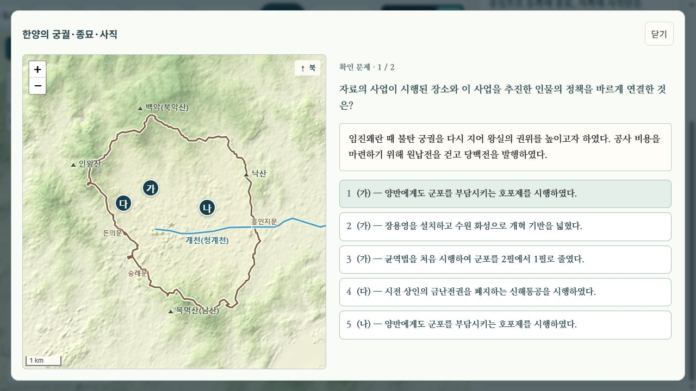
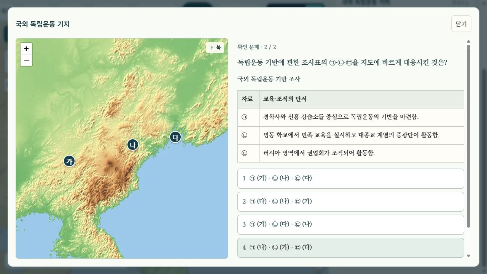
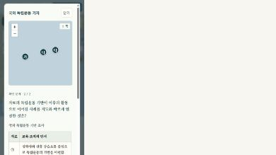

# 역사 지도 객관식 문항 재검토

검토일: 2026-10-12. 대상: 국내 지도 고등 역사 37개 장면, 74문항.

후속 변경: 사용자의 간결한 수능 대비 문항 요청에 따라 45문항의 자료·질문·선택지를 줄였다. 현재 버전과 검증은 [문항 간결화 기록](../concise/README.md)에 있다. 아래 39문항 개편과 화면 캡처는 간결화 이전 기록이다.

## 수집과 분석을 구분한 확인 결과

- 천재교과서 한국사1·2 각 1~3단원의 단원평가 HWP 6개와 통합 정답·해설 HWP 2개가 있다. 각 단원평가는 2회 × 20문항으로, 객관식 240문항의 본문을 추출했다. 정답 파일에 함께 들어 있는 서술형은 앱에 도입하지 않았다.
- `references/textbooks/EBS/기출`에는 파일명 `한국사_문제_`에 해당하는 PDF 272개, `한국사_해설_` PDF 272개가 있다. 문제지 SHA-256 중복을 제거해도 272개이다. 이 수는 보관 파일 수이며 현 교육과정의 고유 문항 수나 검토 완료 수가 아니다.
- [전일 기록](../../korea-map-review-2026-10-11/questions/README.md)에도 교과서와 일부 단원평가를 대조한 기록은 있다. 그러나 본문 추출·기능 검사와 전체 평가문항의 질적 분석은 다르다. 기존 두 문항이 같은 사실을 반복하거나, 자료 없이 지명·정책만 대응시키는 문제가 남아 있었다.
- 이번에는 6개 HWP의 추출 본문을 검토하고 관련 정답·오답 해설을 대조했다. HWP 그림은 한국사1 2단원 및 한국사2 1단원의 추출 그림을 추가 확인했다. 모든 HWP 페이지의 원래 배치와 그림 속 문구를 전수 확인한 것은 아니다.
- 보관된 **2027학년도 6월·9월 평가원 모의평가 한국사**(2026년 시행) 2개 문제지의 40문항은 본문과 렌더링한 8페이지를 읽었다. 해당 해설도 추출해 관련 문항을 대조했다. 나머지 기출 270개를 읽었다고 주장하지 않는다.
- 파일 경로·해시는 [sources.json](sources.json)에 기록했다. 교과서·시험지 원본 및 추출 전문은 공개 앱이나 이 문서 폴더에 복제하지 않았다.

## 실제 문항에서 확인한 출제 방식

| 대조 자료 | 요구되는 판단 | 앱에 반영한 점 |
| --- | --- | --- |
| 한국사1 1단원 1회 2번 | 풍습 자료로 국가를 판별한 뒤 지도 위치 선택 | 옥저·동예 자료와 동해안 위치를 함께 판단 |
| 한국사1 1단원 1회 3·6번 | 왕의 활동 구별, 서로 다른 사건의 순서 판단 | 백제·고구려·신라의 정책 주체와 천도·전투 시기 구별 |
| 한국사1 1단원 1회 19·20번, 2회 20번 | 흥선 대원군의 정책과 당백전 자료 해석 | 경복궁 위치 → 중건 단서 → 호포제, 영조·정조 정책과 구별 |
| 한국사2 1단원 2회 7번 | 학교·단체 단서로 국외 기지 위치 판별 | 서간도·북간도·연해주의 교육·조직을 표와 지도에서 대응 |
| 한국사2 1단원 1회 17·19·20번, 2회 10·19번 | 부대·활동 지역, 이동 순서, 연합 작전의 역할 구별 | 독립군 이동, 임시 정부 이동, 조선 의용대의 분화, 광복군 활동 비교 |
| 2027학년도 6월 모평 1·3·5번 | 유물·유적 지도 해석, 두 사료 사이의 사실, 연표 구간 판단 | 자료 단서와 지도·시간 조건을 함께 확인하도록 구성 |
| 같은 시험 7·9·10·12·16번 | 사건 판별 후 결과·조약·단체·배경 연결 | 사건명만 외우는 질문에서 원인·결과와 정책 연결로 확장 |
| 2027학년도 9월 모평 4·7·12·14·17·20번 | 사료의 시기, 침입 경로, 독립운동 단체, 헌법 변화 판단 | 비슷한 사건·조직·정책을 오답으로 두고 해설에서 차이를 설명 |

실제 평가원 시험에도 기본 사실을 확인하는 쉬운 문항이 있다. 난도를 높이기 위해 모든 문장을 길게 쓰거나 지엽적인 사실을 넣지는 않았다. 지도 학습에서는 지점을 식별하고 자료와 연결하는 단계가 실제 정답 판단에 쓰이도록 했다.

## 교과서의 사실 근거

전일 읽은 교과서 범위와 공식 자료 링크는 위 전일 기록에 있다. 이번 추가 대조의 쪽수는 PDF 페이지 순번이다.

- 천재 한국사1 전체 교과서: 14쪽 무령왕의 22담로·성왕의 사비 천도, 35쪽 훈련도감과 군제 개편, 41쪽 도당 유학생·골품제, 124쪽 전주 화약 이후 일본의 경복궁 점령과 재봉기, 39쪽 경복궁 중건·원납전·당백전, 52쪽 별무반·동북 9성 개척과 반환.
- 천재 한국사2 1단원 교과서: 25쪽 국외 기지의 학교·단체 지도, 32쪽 북로 군정서와 청산리 전투, 61쪽 조선 의용대 화북 지대·조선 의용군 및 광복군의 OSS 훈련.
- 천재 한국사2 전체 교과서: 96쪽 부산 정치 파동·발췌 개헌과 사사오입 개헌.
- 충주 고구려비는 남한강 유역 진출의 근거로 사용하고 건립 연도를 확정하지 않았다. 원본 그림에서 떨어져 나온 숫자만으로 연도별 통계를 만들지 않았다.

추가 연도 대조: [국사편찬위원회 홍건적의 침입](https://contents.history.go.kr/mobile/kc/view.do?levelId=kc_i201500)에서 1361년 개경 함락, [국사편찬위원회 훈련도감](https://contents.history.go.kr/front/tg/print.do?levelId=tg_003_2220&treeId=&whereStr=)에서 1593년 설치·1594년 삼수병 체제 완성을 확인했다.

## 수정 결과

- 37개 장면의 두 번째 문항 전부와 한양·광복의 첫 문항, **총 39문항**을 수정했다. 기본 확인 역할의 첫 문항 35개는 유지했다.
- 한 장면의 두 문항을 함께 다시 읽어 정답의 지식이 겹치는 다섯 쌍을 추가 수정했다. 신라 교역은 유학생과 골품제, 쌍성총관부는 홍건적 침입의 시기, 임진왜란은 훈련도감, 동학은 일본의 경복궁 점령·청일 전쟁으로 두 번째 판단을 구별했다.
- 국외 기지의 두 번째 문항은 최종 검토에서 첫 문항과 지식이 중복되는 것을 발견해 다시 수정했다. 기지의 단체명 대응에서 중광단→북로 군정서, 신흥 강습소→신흥 무관학교, 청산리 전투·하와이 국민 군단·국내 독립 의군부의 구별로 확장했다.
- 자료 → 지점 식별 → 시기·정책·관계 판단으로 이어지는 문항, 두 자료 사이의 사건, 학교·부대·민주화 운동 비교표를 추가했다.
- 해설에 정답의 근거와 오답이 혼동한 시대·장소·인물·제도를 적었다.
- 문항 ID는 유지하되 수정한 문항의 `revision`을 4로 올리고, 국외 기지·신라 교역·쌍성총관부·임진왜란·동학의 두 번째 문항은 최종 중복 검토 후 5로 올려 이전 내용의 기록과 구별했다.
- [question-review.json](question-review.json)에 수정 39문항의 판단 유형·자료 형식·해설·원본 유형 참조를 기록했다. **`patternRefs`는 출제 방식의 비교용 참조이며, 같은 역사 사실의 직접 출처나 원문 전사를 뜻하지 않는다.**
- 원본을 베낀 문항으로 소개하지 않는다. 앱 자료는 학습 내용을 바탕으로 재구성한 문장이다.

## 화면과 채점 확인

- 사료·보기·표를 구분하고 본문은 시험용 바탕체 17px, 선택지는 16px로 표시했다. 넓은 화면은 지도와 문항을 나란히, 좁은 화면은 위아래로 배치한다.
- 다음 문항에서 첫 선택지로 초점이 이동해 자료가 가려지는 문제를 수정했다. 문항 시작으로 돌아가 자료부터 읽을 수 있다.
- 화면 크기를 줄이면 문제 지도도 전체 지점이 들어오게 다시 맞춘다. 모바일 표의 첫 열 제목이 한 글자씩 줄바꿈되지 않게 했다.
- 37개 장면의 74문항을 실제 브라우저에서 열고 **오답 → 재시도 → 정답 → 다음/결과**를 확인했다. 오답에서 정답·해설을 노출하지 않았고, 두 번 모두 첫 응답이 틀리면 결과도 0/2였다. [기록](browser-results.json)
- 1280×720, 390×844에서 사료·비교표·지도 배치를 확인했다. 가로 넘침 없음, 축소 후 모든 지도 지점이 화면 안에 있음, 검사 탭 콘솔 오류 없음.
- `node --test tests/history-map-questions.test.cjs tests/history-local-map.test.cjs tests/objective-school-practice.test.cjs tests/model-scope-history.test.cjs`: 14개 통과. 관련 JS 구문 검사 통과.
- 아래 캡처는 PNG 바이트를 메모리에서 무손실 WebP로 변환했다. 디코딩 후 크기·RGBA 픽셀 일치를 확인했다.

이 기록은 고등 역사 문항 개편과 명시한 자료·기능 검토의 결과다. 전체 기출의 전수 분석, 학생 응답에 따른 난이도·변별도 측정, 초·중·과학 문항 전체 검증을 완료했다는 뜻은 아니다.
