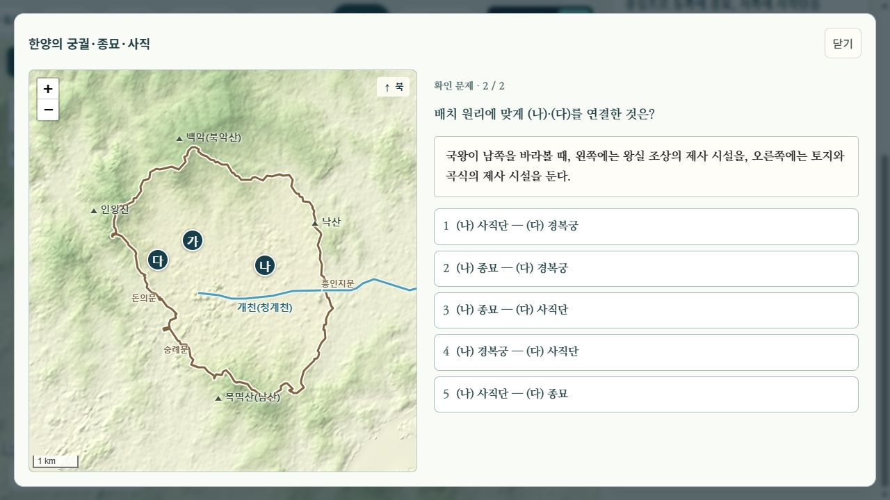
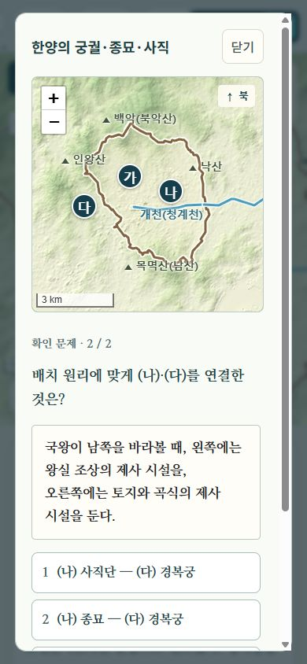

# 수능 대비 문항 간결화

2026-10-12. 사용자 요청: 수능 형식의 긴 지문을 재현할 필요 없이, 수능 대비에 필요한 내용을 깔끔하게 묻는다.

## 적용

- 고등 역사 지도 37개 장면의 74문항을 다시 읽고, 둘째 문제 37개와 긴 첫째 문제 8개를 수정했다. 변경 문항은 revision 6으로 올려 기존 응답 기록과 구분했다.
- 지도 위치·사건의 순서·정책 주체·원인과 결과를 묻는다. 한 문항에 자료 대응, 보기 네 개 판단, 정답 조합 선택을 거듭 붙이던 구성을 줄였다.
- 자료는 풀 때 필요한 단서만 둔다. 지도만으로 질문할 수 있으면 별도의 지문을 강제로 추가하지 않는다.
- 선택지는 5개를 유지하되 반복하는 수식어·설명 문장을 줄였다. 자세한 정답 근거와 오답의 차이는 해설에 둔다.
- 수정 45문항의 질문·자료·보기·선택지 합계는 12,738자에서 5,595자로 감소했다(해설·공통 UI 제외). 글자 수는 분량 비교이며 난이도·변별도의 측정값이 아니다.
- [선행 교과서·평가자료 검토](../assessment/README.md)의 사실 대조를 바탕으로 구성과 표현을 바꿨다. 해당 문서의 39문항 개편·브라우저 전수 확인은 간결화 이전 버전의 기록이다.

## 확인

- 74문항 전체의 선택지 중복, 정답 범위, 지도 좌표·기호, 버전, 남아 있는 사료 기호를 검사했다. 관련 Node 테스트 14개 통과.
- 브라우저에서는 한양·발해·임진왜란·국외 독립운동 기지·조선 의용대·고구려 남진의 12문항을 풀었다. 오답에서 답·해설을 공개하지 않았고, 재시도 정답 뒤에도 최초 응답이 오답이면 결과는 0/2로 유지됐다.
- 1280×720과 390×844에서 한양 문항의 줄바꿈·가로 넘침을 확인했다. 모바일에서는 지도와 문제를 세로로 읽는다. 별도 제목 줄이나 추가 버튼은 만들지 않았다.
- 캡처는 PNG 바이트를 메모리에서 무손실 WebP로 변환했고 크기·RGBA 일치를 확인했다.
- [문항별 변경·브라우저 기록](review.json). 이번에는 내용 변경을 검증했으며, 문항 풀이 기능 전체를 새로 구현한 것은 아니다.

