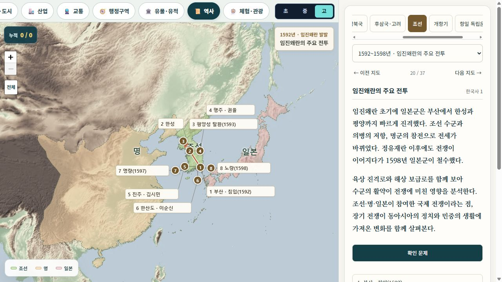

# 임진왜란 지도의 명 영역 수정

## 확인된 오류

`build_history_territories.py`가 Natural Earth의 현대 중국 국가 도형을 `명`으로 그대로 표시했다. 이 때문에 티베트·신장·내몽골·만주 북부까지 같은 색으로 나타났다. `1592년`이라는 표제와 일치하지 않는 역사 내용 오류였다.

## 수정

- 임진왜란 장면의 명 영역을 별도 역사 도형으로 교체했다. 북방은 만리장성·요동 방면, 서방은 가욕관·감숙 방면의 원본 경계를 따른다.
- 현대 국가 도형은 역사 도형을 육지·해안에 맞추는 마스크로 사용한다. 티베트·중앙아시아·몽골·만주 전체를 명의 지배 영역으로 채우는 대체 도형으로 사용하지 않는다.
- 대만과 남중국해의 먼 섬은 명의 색칠에서 제외한다. 하이난은 포함한다.
- 명의 초기 화면 바깥 영역과 범례를 유지한다. 축소했을 때 `명`이 실제 영역에 나타난다. 일본 이름도 부산 가까운 작은 섬에서 혼슈 쪽으로 옮겼다.
- SVG와 manifest의 캐시 버전을 함께 변경했다. 임진왜란 외 장면의 영역은 이번 수정 대상이 아니다.

## 근거와 재현

주요 원본은 F. W. Mote, *Imperial China 900–1800* (1999), 640쪽의 **The 15 Provinces of Ming China about 1580**이다. 코펜하겐대학교 Leif Littrup의 [수업용 지도 모음 PDF 5쪽](https://littrup.sites.ku.dk/files/2015/05/Kin-ter.pdf#page=5)에서 확인했다.

수집된 미래엔 역사부도(한철호, 2015), 세계사 2단원 인쇄 141쪽의 명·청 영역 비교도와 미국 의회도서관 [China: A Country Study, 인쇄 12쪽 / PDF 60쪽](https://tile.loc.gov/storage-services/master/frd/frdcstdy/ch/chinacountrystud00word/chinacountrystud00word.pdf#page=60)도 대조했다. 전자의 `명의 최대 영역`을 1592년 영역으로 대체하지 않았다. 하버드 Hartwell 자료는 해당 시점이 1391년이고 원본도 근사 행정구역이라고 설명하므로 채택하지 않았다.

원본 PDF는 로컬 `tmp/ming-territory-review/`에만 보관한다. 공개 앱에 교과서·학술 지도 원본을 싣지 않는다. `tools/ming-1580-reference.json`에 원본 픽셀 좌표, 도시 기준점 12개, 투영법, 출처를 기록했다. `history_ming.py`가 투영 좌표에서 아핀 등록 후 WGS84로 변환한다.

등록 오차는 도시 기준점 RMS 약 25km, 최대 약 46km이다. 이 지도는 16세기 말의 **개략 지배 영역**이며, 1592년 하루의 측량 국경이나 개별 위소·토사·조공 관계를 정밀 복원한 결과가 아니다. 경계 바로 위의 작은 지점을 확정 판별하는 용도로 쓰지 않는다.

```text
python learning/inquiry/korea-map/tools/build_history_territories.py --countries outputs/korea-map-history/references/ne-countries-50m.geojson --coast tmp/history-boundary-review/ne_10m_admin_0_countries.geojson --only imjin
python -m unittest discover -s tests -p test_history_ming.py
```

의존성: NumPy, Shapely, pyproj.

## 확인

- 생성된 실제 SVG를 검사: 베이징·난징·요양·선양·개원·쿤밍·주취안·하이난 포함.
- 라싸·우루무치·하미·울란바토르·하얼빈·창춘·대만·서울·하노이·남중국해 지점 제외.
- 브라우저에서 초기 화면과 3단계 축소 화면 확인: 영역 이미지 디코딩, 명의 범례와 국가 이름 정상, 콘솔 오류 없음.
- 원본과 무관한 전체 역사 지도 검증이 완료됐다는 의미는 아니다.


