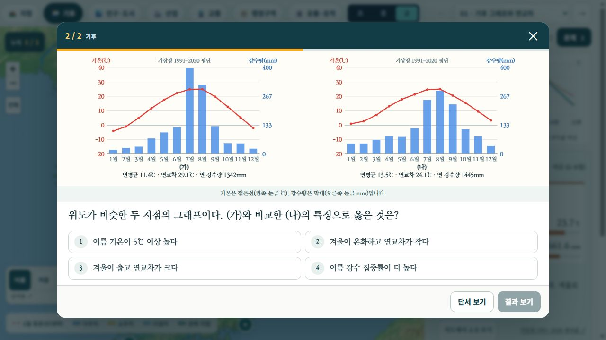
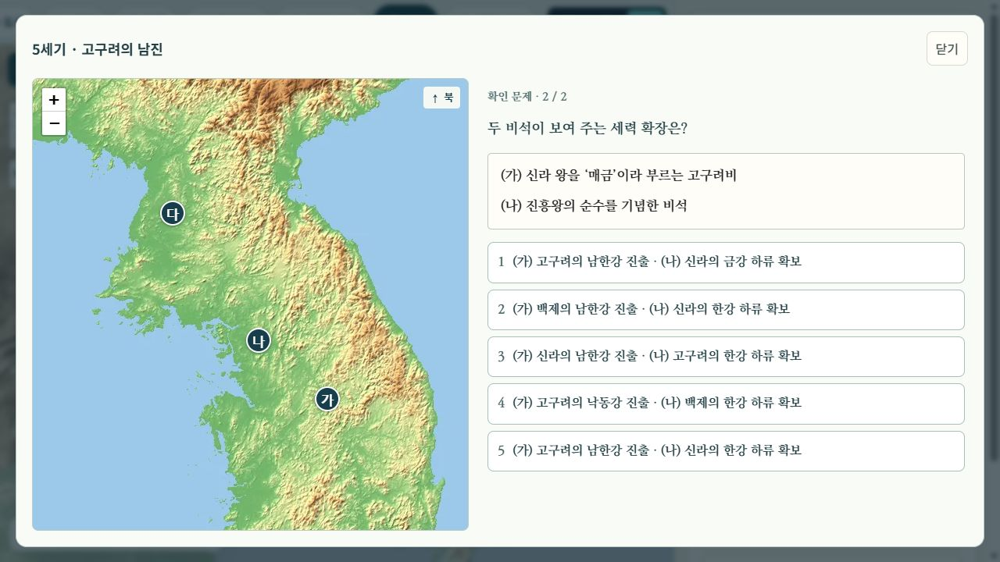

# 국내 지도 고등 문항의 질 재검토

2026-10-12. 사용자가 지적한 단순 확인 문항, 허술한 오답, 지도와 문항의 약한 연결을 재검토했다.

## 확인한 문제와 수정

- 지리 78문항 중 **47문항의 질문·보기·해설·자료를 수정**했다. 역사 74문항 중 **10문항을 수정**했다. 문항 수를 늘린 작업은 아니다.
- 지리에서는 단일 용어 확인을 위치와 지형 형성 과정의 연결, 두 지역의 비교, 비율과 실제 규모의 구별, 조건에 따른 입지 판단으로 바꿨다. 농업과 촌락에서 같은 대관령·수도권 비교가 반복되는 것도 제거했다.
- 예: 노령 인구 비율 하나를 묻던 문항은 **노령화 지수와 총부양비의 방향이 다른 두 지역**을 비교하도록 바꿨다. 하천·해안은 위치나 단면을 읽은 뒤 침식·퇴적 조건을 판단한다.
- 역사에서는 옥저·동예의 두 풍습과 위치, 충주·북한산 비석과 진출 범위, 웅진도독부·안동도호부의 중심지, 의거 장소와 임시 정부 이동 등을 연결한다. 신라·발해 교역 문항은 청해진·등주·적산·양저우의 위치를 구분한다.
- 문제 전용 SVG 8종을 만들었다. 설명용 그림의 지형 이름·풀이 문장을 그대로 보여 주지 않는다. 한반도 단면, 곡류, 범람원, 해안, 카르스트, 푄, 전통 지도 기호, 식생 경계 자료다.
- **추가 1문항**인 춘천·강릉 기후 비교는 질문을 유지하고 표시 오류를 고쳤다. `showMap:false`가 그래프까지 숨기던 문제가 있었다. 두 그래프를 넓은 화면에서 나란히, 좁은 화면에서 위아래로 표시하고 단위 잘림을 수정했다.
- 이전/이후 문항과 기준 커밋은 [question-changes.json](question-changes.json)에 있다. 내용 개편 57문항, 표시 변경까지 포함하면 58문항이다. 수정 문항의 revision을 올려 예전 응답 기록과 구별했다.

## 자료 대조 범위

원본 보관 여부와 전수 분석 여부를 구분한다. 자료의 경로·해시는 [지리 자료 기록](../remaster/source-review.json), [역사 평가 자료 기록](../assessment/sources.json)에 있다.

- 기존에 검토한 미래엔 한국지리·지리 부도와 천재 한국사·단원평가의 근거를 다시 사용했다. 이번에는 한국지리 PDF 순번 60·69·82~84·98·128·149쪽을 추가 대조했다. 촌락의 용천대·자연 제방 입지, 산업 구성비와 규모, 노령화 지수와 부양비의 분모를 확인했다. 산업 문항에 불필요하게 추가했던 ‘입지 계수’는 제거했다.
- 보관된 2027학년도 6월 한국지리 모의평가의 20문항 본문과 1·4면을 읽고, 6월·9월 해설에서 관련 유형을 대조했다. 하천·해안 자료, 지역별 기후, 복수 조건 GIS, 도시 인구 구성비 등의 판단 방식을 참고했다. 원문 문항을 복제하지 않았다.
- 역사 단원평가에서 풍습→국가→위치, 왕의 활동·사건 순서, 독립운동 장소와 조직을 연결하는 유형을 대조했다. 앞선 [평가 자료 분석 기록](../assessment/README.md)과 [간결화 기록](../concise/README.md)의 전체 수집·검토 범위를 그대로 유지한다.
- 문왕 시기의 체제 정비와 대당 관계는 국사편찬위원회 [발해의 성립과 발전](https://contents.history.go.kr/front/kc/printViewPopup.do?levelId=kc_n101100), [발해의 발전](https://contents.history.go.kr/front/ta/view.do?levelId=ta_m51_0050_0020)을 추가 대조했다.
- 수치 비교표는 실제 통계와 혼동되지 않도록 ‘학습용 가상 자료’ 등으로 표시했다. 푄의 감률 계산은 주어진 조건을 적용하는 모형이며 감률 암기를 요구하지 않는다.

## 검증

- 지리 **39개 개념, 78문항**을 실제 브라우저에서 열었다. 지도·표·그림·그래프 표시, 오답 선택 후 정답·해설 미노출, 다른 보기 재선택, 정답 채점과 다음 문항 이동을 확인했다. [지리 기록](geography-browser.json)
- 수정된 역사 **10개 장면의 두 문항씩, 20문항**을 실제 브라우저에서 같은 흐름으로 확인했다. 지도 표식과 제시 자료도 확인했다. [역사 기록](history-browser.json)
- 1280×720 및 390×844에서 그래프와 역사 자료를 확인했다. 모바일 창의 가로 넘침이 없고, 긴 실제 학습 내용은 세로로 스크롤한다.
- 단위 검사 15개 통과: `node --test tests/korea-remaster.test.cjs tests/history-map-questions.test.cjs tests/objective-school-practice.test.cjs`. 표시할 자료의 우선순위, 실제 표 수치로 계산한 정답, 지도 지점 참조, 기상청 원자료 일치 등을 검사한다.
- 캡처는 메모리의 PNG 바이트를 무손실 WebP로 저장했다. 크기와 디코딩된 RGBA 픽셀 일치를 [capture-checks.json](capture-checks.json)에 기록했다.

이 기록은 명시한 문항과 자료·풀이 흐름의 검토 결과다. 모든 기출의 전수 분석이나 학생 응답을 통한 난이도·변별도 측정을 완료했다는 뜻은 아니다. 이번 작업에서 국내 지도 전체의 모든 시대별 경계를 다시 검증하지는 않았다.
