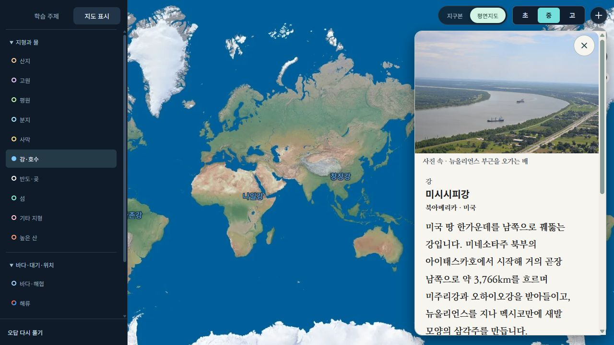
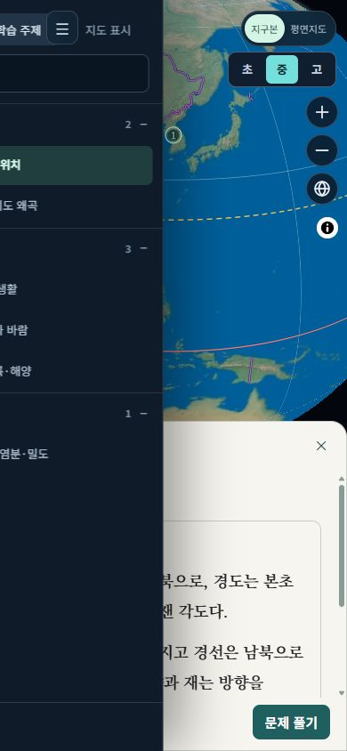
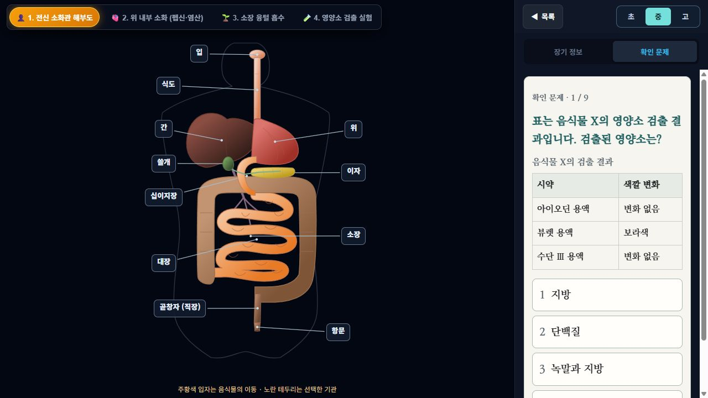
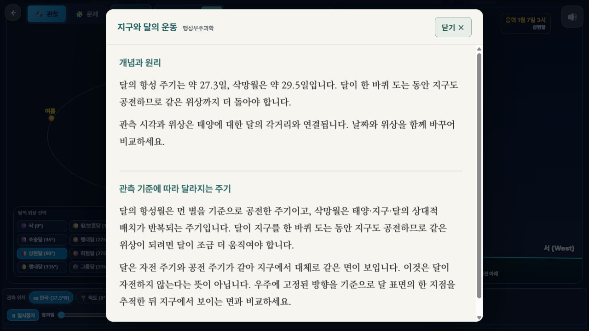
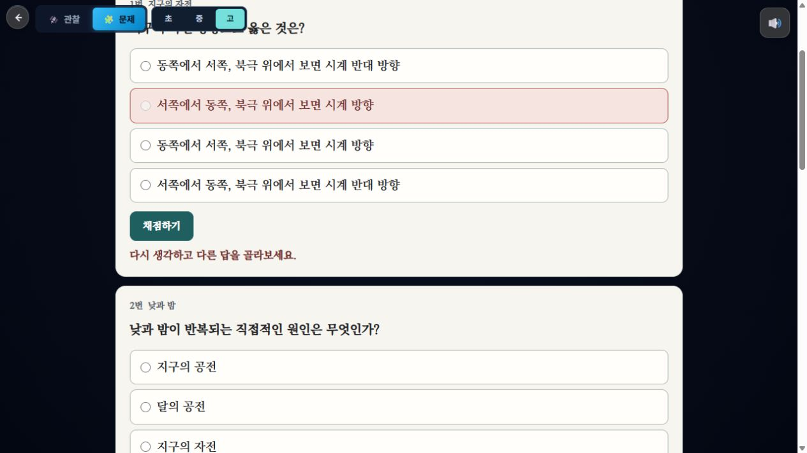

# 읽기 배색과 세계지도 상단 여백 수정 — 2026-10-11

## 수정

- 세계지도의 학교급 공통 CSS가 다시 만들던 60px 상단 행을 제거했다. 지도는 화면 맨 위에서 시작하며 지도 전환·학교급 버튼만 위에 떠 있다.
- 좁은 데스크톱과 모바일에서는 버튼을 두 줄로 나누되 지도 영역의 높이를 차감하지 않는다. 모바일 지도 출처 버튼과 확대·축소 버튼의 겹침도 해소했다.
- 설명을 닫은 뒤의 `학습 카드 열기` 버튼은 확대·축소 버튼과 겹치지 않도록 오른쪽 아래에 둔다.
- 세계지도 지명 설명·학습 패널·객관식 문제창을 불투명 미색 `#F7F5EF` / 짙은 글씨 `#202124`로 바꿨다. 긴 설명은 19px, 모바일은 18px이며 바탕체를 유지한다. 지명 설명창의 최대 너비는 400px이다.
- 공통 읽기 스타일을 인체 8개, 우주 3개, 물질 모형, 세계지도, 국내지도의 진입 HTML 14개에 연결했다. 교과 설명·문제·해설에 밝은 배경과 진한 글씨를 적용하고, 우주의 라디오형 문제 및 별도 원소 퀴즈도 포함했다.
- 인체에서 확인 문제 탭을 선택하면 관찰 안내·장기 상세·관찰 조작 버튼을 접어 문제가 위에서 시작하도록 했다. 장기 정보 탭에서는 기존 관찰 안내와 조작을 볼 수 있다.
- 모형의 Canvas/SVG와 지도 자체의 색상은 읽기 패널 배색에 포함하지 않는다. 문제의 경위도 도표는 밝은 종이 배색에 맞추었다.

## 브라우저 확인

- 세계지도 1280×720: 지도 `top=0`, 높이 720px. 기존 `top=60`, 높이 660px에서 60px를 회복했다.
- 세계지도 1000×760에서 양쪽 패널을 연 상태: 지도 `top=0`, 학교급 버튼과 지도 전환 버튼이 지도 안쪽에 겹치지 않고 표시된다.
- 세계지도 390×844: 지도 `top=0`, 페이지 가로 넘침 없음. 확대·축소 버튼 끝 230px / 출처 버튼 시작 244px.
- 지명 설명창의 실제 계산 스타일: 배경 rgb(247,245,239), 글자 rgb(32,33,36), 19px, Class Exam Batang.
- 인체 소화계: 설명·문제의 배색 확인. 확인 문제 탭에서 관찰 안내 `display:none`, 문항 시작 y=138, 자료표 16px.
- 우주 지구와 달: 설명 팝업은 같은 배색의 20px 바탕체. 라디오형 문제 보기 19px. 오답에서 재선택 안내만 보이고 해설은 숨겨진 상태를 유지한다.
- 물질 모형: 관찰 결과 설명의 배경·본문 대비와 별도 원소 퀴즈의 배색·바탕체를 확인했다.
- 세계지도 문제: 오답 보기의 대비, 정답 미공개, 재선택 안내 유지 확인.
- 14개 진입 페이지의 CSS 경로 존재 검사 및 범위 내 `git diff --check` 통과.

이 기록은 로컬 브라우저의 UI 확인이다. 운영 사이트 배포 상태나 전체 문항의 학술적 정확성에 대한 추가 검증을 의미하지 않는다.

## 화면

